# Hotel Reservation Management System

**Final technical report**


**Official project name**

Sistema de Gestión de Reservaciones de Hotel

**Author**

Sergio Garduño Arriaga

**Institution**

Centro Universitario UAEMéx Atlacomulco

**Course**

Paradigmas de Programación I

**Group**

ICO 30

**Academic term**

2026B

<!-- page -->

## Contents

| Section | Page |
| --- | ---: |
| [1. Introduction](#1-introduction) | 3 |
| [2. Objectives methodology and scope](#2-objectives-methodology-and-scope) | 4 |
| [3. Functional requirements](#3-functional-requirements) | 5 |
| [4. Nonfunctional requirements and delivery criteria](#4-nonfunctional-requirements-and-delivery-criteria) | 6 |
| [5. Technologies and MVC architecture](#5-technologies-and-mvc-architecture) | 7 |
| [6. Package organization and MySQL model](#6-package-organization-and-mysql-model) | 8 |
| [7. Security and roles](#7-security-and-roles) | 9 |
| [8. Application modules](#8-application-modules) | 10 |
| [9. Validation exceptions and concurrency](#9-validation-exceptions-and-concurrency) | 11 |
| [10. Validation and results](#10-validation-and-results) | 12 |
| [11. Evidence of operation](#11-evidence-of-operation) | 13 |
| [12. Conclusions](#12-conclusions) | 20 |
| [References](#references) | 21 |
| [Appendix A UML diagrams](#appendix-a-uml-diagrams) | 22 |
| [Appendix B Supporting materials](#appendix-b-supporting-materials) | 32 |

The page numbers refer to the final paginated report. Figures 1-14 show the application. Figures A1-A16 document the implemented design.

<!-- page -->

## 1. Introduction

**ReservacionesHotel** is a local web application for managing a small hotel's inventory, reservations, simulated payments, and guest stays. It supports three roles with different responsibilities. Guests can search for rooms and manage their own reservations. Reception staff maintain guest records, review simulated payments, and record arrivals and departures. Administrators manage room types and rooms.

The project was developed for **Paradigmas de Programación I** as an incremental implementation. The final application demonstrates an entire workflow with a relational database, from adding a room type to completing a stay. The academic scope includes manually reviewed simulated payments and a local demonstration environment.

### Problem statement

The original requirements brief describes a hotel that checks room availability manually. That makes it harder to distinguish an occupied room from a room reserved for later dates. It also creates opportunities for overlapping bookings, incomplete records, and inconsistent amounts when a reservation changes. The system addresses these issues by checking each requested interval and recording each reservation, payment attempt and stay transition in a shared database.

### Justification

A web application gives the three roles access to the same information while limiting what each can do. The booking workflow benefits from keeping planned dates separate from actual arrival and departure timestamps. The hotel can quote a nightly rate, preserve the agreed amount, and compare it with the approved payments after a change. A relational model and database transactions help preserve that history even when two requests arrive together.

### Project evidence

This report is based on the Java implementation, the four Flyway migrations, the original requirements and UML materials, and the test evidence reviewed for the published Stage 11 baseline. The Git history records separate increments for persistence, role-based access, inventory, availability, reservations, payments, stays and final verification. [Stage 11 commit on GitHub](https://github.com/Sergio1200/SistemaReservacionesHotel/commit/db1a2794c55e0b9e3ce41c5e7b2b3386ac54c022)

<!-- page -->

## 2. Objectives methodology and scope

### General objective

Develop a hotel reservation system that helps staff manage rooms and stays while allowing guests to search for availability and manage their own bookings.

### Specific objectives

- Store guests, employees, rooms, reservations, and payment attempts in MySQL with explicit relationships.
- Provide Java web forms with validation and distinct permissions for guests, reception staff, and administrators.
- Recheck room capacity and date overlap before confirming a write, and maintain consistent states under concurrent requests.
- Preserve quoted rates and approved payments across reservation changes, cancellation, check-in and check-out.
- Provide reproducible installation steps, evidence for the course requirements, and a live demonstration of the complete academic workflow.

### Methodology

1. Review the original problem statement, actor descriptions, and RF01-RF14 in the course presentation. Use the corrected PlantUML archive to compare the conceptual design with the implemented classes.
2. Develop the application in layers and small increments. The Git history records the features separately. Compare each diagram with controller mappings, service rules, JPA annotations, and SQL constraints.
3. Verify controller behavior with JUnit and MockMvc, test versioned schema changes, and run integration and concurrency cases against isolated MySQL 8.0.46.
4. Complete the fictional workflow in Edge, from inventory setup to check-out. Record the observed results in the test matrix and turn selected captures into report figures.

### Scope and limitations

The project covers guest records, inventory, booking, payment simulation, and stay operations. It does not process bank transactions, store card details, or issue real refunds. Legacy reservations with incomplete check-in times or inconsistent balances may require an administrative review. No quantitative load target or sustained load measurement is available. The documentation records those limits and distinguishes the app's observed behavior from the original conceptual design.

<!-- page -->

## 3. Functional requirements

The identifiers follow the original project presentation. This table summarizes observed coverage. The evidence references map to the full test matrix and the requirements review in Appendix B.

| ID | Original requirement | Implementation and verification |
| --- | --- | --- |
| RF01 | Check availability by dates and guest count. | Public search with capacity and interval checks. E04, A07-A08. |
| RF02 | Create a reservation for an available room. | A guest books for their own account. Reception may select an existing guest. E05, A09-A10. |
| RF03 | Calculate the cost from nights and nightly price. | Exact decimal calculation and saved historical rate. E05, A08, A11. |
| RF04 | Modify a reservation and recheck availability. | Dates, room, and guest count can change within rules for state, capacity, and payments. E10, A12, A17. |
| RF05 | Cancel a reservation when its state permits it. | Cancels before check-in and preserves the history. A13. |
| RF06 | Search reservations by ID or guest data. | Reception can search by ID, name, or email. Guests see their own records. A06, A14. |
| RF07 | Record one or more payments. | Simulated attempts with ID, date, amount, method, and state. E06, A15-A16. |
| RF08 | Validate a payment before confirming it. | Reception reviews the simulated attempt. Approved totals drive booking confirmation. E07, A15, A17. |
| RF09 | Register check-in for a valid confirmed booking. | Reception checks dates, capacity, and actual occupancy. E08, A18, A21. |
| RF10 | Register check-out and release the room. | Finalizes the stay. Release depends on whether another active stay remains. E08, A19, A21. |
| RF11 | Store guest ID, name, phone, and email. | Public registration or reception creates a guest record. E03, A02, A24. |
| RF12 | Let administrators manage rooms. | Room details and initial state are captured. Later occupancy changes follow stay operations. E02, A04, A25. |
| RF13 | Manage room types, capacity, and description. | Room type CRUD with reference checks. E02, A25. |
| RF14 | Provide authenticated staff access with distinct functions. | Separate staff roles, email sign-in, and access checks. E01, A03-A05. |

<!-- page -->

## 4. Nonfunctional requirements and delivery criteria

| ID | Requirement | Observed evidence |
| --- | --- | --- |
| RNF01 | Usability | Edge review at 1440, 768, 390, and 320 px. The tested forms, menus, feedback, and tables fit their intended views. |
| RNF02 | Security | Role checks, guest ownership, BCrypt verification, CSRF, and session termination passed. |
| RNF03 | Persistence | MySQL 8.0.46 matched the JPA model. V1-V4 ran in order and preserved sample legacy records. |
| RNF04 | Input validation | Tests exercised missing values, invalid dates, capacity, duplicate emails, invalid amounts, and disallowed states. |
| RNF05 | Reservation integrity | Concurrency tests verified overlap prevention and recovery after a lock timeout. |
| RNF06 | Performance | Functional searches completed. No numeric load target or load benchmark was established. |

### Academic delivery evidence

| Area | Evidence and coverage |
| --- | --- |
| MVC, Spring Boot, and persistence | The package structure and source show MVC controllers, Thymeleaf views, services, JPA repositories and MySQL CRUD. The repositories provide the data access layer. |
| Security and exceptions | BCrypt, role and ownership checks, CSRF and error views are covered in Sections 7, 9 and 10. |
| UML and interface prototypes | Appendix A compares the implementation with the original design. Section 11 uses real captures. Earlier prototypes remain in `docs/interfaz/`. |
| Tests and incremental Git history | Section 10 links the 39-case matrix. The source repository records the published implementation increments through Stage 11. |
| Code, report, manual, and SQL | The delivery index links the source-based report, editable document, local installation manual, and demo SQL resources. |
| Demonstration | Stage 11 verified the full workflow in Edge. The delivery includes a timed live script and an English recording script. |

The available academic materials include the original requirements brief, PlantUML sources, and the presentation that lists the numbered requirements. A separate instructor rubric specifically for this final submission was not available for verification. The comparison uses those original project materials and the final delivery instructions.

<!-- page -->

## 5. Technologies and MVC architecture

| Component | Role in the project |
| --- | --- |
| Java 21 and Spring Boot 4.2.0 | Application runtime and configuration with embedded Tomcat. |
| Spring Web MVC, Jakarta Validation, Thymeleaf | Request mapping, form validation, and server-rendered HTML. |
| Bootstrap 5.3.9 and CSS | Responsive layout with a shared navigation and footer. |
| Spring Security | Form authentication, BCrypt, sessions, CSRF, and role-based authorization. |
| Spring Data JPA, Hibernate, MySQL 8 | Repository queries, entity mapping and InnoDB persistence. |
| Flyway | Versioned SQL migrations applied at startup. |
| Maven 3.9.16 via Maven Wrapper | Reproducible build, test execution, and executable JAR. |
| JUnit Jupiter, MockMvc, H2 and MySQL | HTTP, persistence, migration, and concurrency verification. |

### A representative request

The public form sends `GET /disponibilidad` with `entrada`, `salida`, and `huespedes`. `DisponibilidadController` binds and validates the form. If the fields are valid, the method passes the request to the service and places the returned list in the model.

```java
modelo.addAttribute("resultados", disponibilidad.consultar(
        formulario.entrada(), formulario.salida(), formulario.huespedes()));
```

`DisponibilidadService` validates the period against the hotel clock. `HabitacionRepository.buscarDisponibles(...)` queries room types, room status and conflicting reservations. Thymeleaf uses the `resultados` model attribute to display the estimates in `disponibilidad.html`. Invalid dates remain in the form so the user can correct the affected field. [Spring Web MVC reference](https://docs.spring.io/spring-framework/reference/web/webmvc.html)

Writes follow the same layers. For example, `ReservacionController` accepts the form, `ReservacionService.crear(...)` handles pricing and locking, and JPA writes the new entity to MySQL. Services define the transaction boundaries.

<!-- page -->

## 6. Package organization and MySQL model

The base Java package is `com.hotel.reservacioneshotel`. `ReservacionesHotelApplication` starts the application.

| Package or directory | Responsibility |
| --- | --- |
| `controller` | Request mappings, form records, binding errors, redirects, and model preparation. |
| `service` | Business rules, state transitions, pricing, and transaction boundaries. |
| `repository` | Spring Data JPA interfaces and the availability and locking queries. |
| `domain.usuarios` | `Huesped`, `Cuenta`, `Empleado`, `Recepcionista`, `Administrador`, and `Rol`. |
| `domain.habitaciones` | `Habitacion`, `TipoHabitacion`, and `EstadoHabitacion`. |
| `domain.reservaciones` and `domain.pagos` | `Reservacion`, `Pago`, and the reservation and payment state enums. |
| `config`, `templates/`, `static/` | Security, hotel clock, demo accounts, views, and browser assets. |

### Database and migrations

| Version | Effect |
| --- | --- |
| V1 | Creates `huespedes`, `empleados`, `tipos_habitacion`, `habitaciones`, `reservaciones`, and `pagos`. |
| V2 | Adds `cuentas` for normalized email sign-in. Each account links one employee or one guest. |
| V3 | Adds `clave_intento` and uniqueness within a reservation. |
| V4 | Adds nullable `fecha_hora_check_in` and `fecha_hora_check_out`. |

A room belongs to one room type. Each reservation belongs to one guest and one room. A reservation may have multiple payment attempts. A guest or employee may have at most one linked account. Employee subclasses share the `empleados` table through JPA `SINGLE_TABLE` inheritance, with `rol` as the discriminator.

The database stores monetary values as `DECIMAL(12,2)`. Java uses `BigDecimal`. Planned dates use `LocalDate`, and actual stay times use `LocalDateTime` with the configured hotel time zone. Flyway records migrations in `flyway_schema_history` before Hibernate validates the schema. The ER diagram identifies the six foreign keys. [Flyway documentation](https://documentation.red-gate.com/flyway)

<!-- page -->

## 7. Security and roles

`SeguridadConfig` restricts requests before they reach the MVC controller. `/login` and `/registro` are the entry points for sign-in and public guest registration. Spring Security handles the `POST /login` request. `CuentasUserDetailsService.loadUserByUsername(...)` normalizes the email and obtains the account and its owner from `CuentaRepository`. The BCrypt hash is checked by the configured authentication provider. [Spring Security servlet documentation](https://docs.spring.io/spring-security/reference/servlet/index.html)

| Role | Access |
| --- | --- |
| `HUESPED` | Public search and management of the guest's own reservations and simulated payment attempts. A guest cannot review payments, manage inventory, or record stay transitions. |
| `RECEPCIONISTA` | Guest records, reservation search and management, payment processing and decisions, and check-in and check-out. |
| `ADMINISTRADOR` | Room and room type management. The availability search remains public. |

### Account and session rules

A publicly registered account always receives the guest role. The guest hash is stored in `cuentas.contrasena_hash`. Staff use the hash and active flag in `empleados`, with the role derived from the employee subtype. The session cookie is marked HttpOnly and SameSite Lax. State-changing forms require a CSRF token, including sign-out via `POST /logout`.

### Ownership and error boundaries

Role checks alone do not determine who can see a reservation. The services also compare the reservation owner with the authenticated guest. That rule protects both the reservation detail and its payment history. The interface hides unauthorized actions, while the server enforces the same limits for direct requests. The public error output omits internal exception details and request paths. The test report verifies this boundary for both an HTML request and a JSON request.

<!-- page -->

## 8. Application modules

### Guest records and inventory

`RegistroController` creates a public account through `RegistroHuespedService`. Reception manages guest profiles through `HuespedController` and `HuespedService`. Active accounts or historical relations can prevent deletion. `HabitacionController` and `TipoHabitacionController` serve the inventory forms and protect relations and capacity when changes affect active reservations. An initial room state may be set at creation. Check-in and check-out manage later occupancy.

### Availability and reservations

The booking period is a half-open interval, so one reservation can end on the day another begins. `PENDIENTE`, `CONFIRMADA`, and `EN_CURSO` can block overlapping intervals. The search also considers operational occupancy and its expected release. A new booking starts as `PENDIENTE`. The historical nightly price and total are stored together. Only pending or confirmed reservations can be changed or cancelled. Cancellation frees the interval while preserving the reservation and payment history.

### Simulated payment processing

The form records an amount and a simulated method. Reception moves the attempt from `PENDIENTE` to `PROCESANDO`, then approves or rejects it. Approved amounts reduce the outstanding balance. Pending or processing attempts consume the amount still available for new attempts. A reissued request with the same attempt key and details returns the existing record. A rejected attempt stays in the history. There is no connection to a bank or payment processor.

### Stay operations

Only reception can record check-in and check-out through `/check-in-check-out`. Check-in requires a confirmed reservation, a date within the planned interval, and room capacity and occupancy that permit the operation. It records the hotel-local time and changes the room to `OCUPADA`. Check-out requires an active stay with an actual check-in. It records `FINALIZADA` and releases the room only when no other active stay prevents release. Approved payments and the historical cost remain intact.

<!-- page -->

## 9. Validation exceptions and concurrency

### Validation and responses

Forms check required fields, email format, date order, guest count, and money values. Services check account ownership, available capacity, overlap and business status. For example, an edit cannot reduce a reservation total below its approved payments, or change the total while an attempt is pending or processing. A revised price that leaves an outstanding balance returns an editable reservation to `PENDIENTE`. If approved payments cover the revised total, it becomes or remains `CONFIRMADA`. An unchanged total leaves the state intact.

| Condition | Observed handling |
| --- | --- |
| Invalid identifier or input conversion | HTTP 400 where conversion fails. HTML shows a localized message and a link back. |
| Missing reservation or inventory record | HTTP 404 for an authorized request that references a missing record. |
| Forbidden operation | HTTP 403 for a role mismatch, an access to another guest's reservation, or missing CSRF in protected forms. |
| Conflicting stay operation or lock timeout | HTTP 409 with a recovery message on applicable routes. Business validation may also return the form with field errors. |

`error.html` preserves the HTTP status and provides a short response in the application's Spanish interface. JSON responses omit protected error attributes. Operational logs retain the exception category or database lock diagnostic without printing the tested credentials.

### Concurrent writes

Reservation, payment, and stay writes run at `READ_COMMITTED` and coordinate access using pessimistic row locks. A new reservation locks its room before it rechecks availability. Edits lock the reservation first and then any rooms in ascending ID order. Payment review locks the reservation and the payment, then reads the current balances. Stay operations lock reservation and room before committing state and timestamps. The checks and writes stay inside the same transaction. [MySQL InnoDB locking](https://dev.mysql.com/doc/refman/8.0/en/innodb-locking.html)

Real MySQL tests covered conflicting room dates, concurrent approvals, duplicate check-in and check-out, and recovery after a lock timeout. In each timeout case the database retained a diagnostic, the request returned a clear response, and the attempted operation left no partial changes.

<!-- page -->

## 10. Validation and results

The Stage 11 publication logs report 197 tests in the H2 suite, including 16 skips reserved for MySQL concurrency. The isolated MySQL suite reran the supported integration tests and those 16 concurrency cases. The final documentation stage reran `clean verify` against the same application sources.

| Run | Passed | Failures | Errors | Skipped |
| --- | ---: | ---: | ---: | ---: |
| Stage 11 H2, Java 21.0.13.1 | 181 | 0 | 0 | 16 |
| Stage 11 MySQL 8.0.46 isolated | 177 | 0 | 0 | 0 |
| Stage 12 `clean verify`, Java 21.0.13.1 | 181 | 0 | 0 | 16 |

### Summary of the 39-case evidence matrix

| Group | What was checked |
| --- | --- |
| Registration, authentication, and roles | Duplicate email, BCrypt, forbidden access, ownership, sign-out, and CSRF. |
| Inventory, availability, and reservations | CRUD constraints, field validation, interval overlap, cost, editing, cancellation, and historical tariffs. |
| Simulated payments and stays | Amounts, duplicate attempts, approval, balance after repricing, arrival and departure. |
| Data and concurrent writes | Foreign keys, legacy rows, duplicate operation protection and lock timeout recovery. |
| Browser and appearance | End-to-end flow and 76 view or state checks across four viewport widths. |

The evidence matrix distinguishes Edge sequences, manual visual inspection, direct MySQL checks, and JUnit or MockMvc tests. The browser run first checked a future interval. It then used a fictional reservation for the current hotel-local day, so the demonstration could complete check-in and check-out under normal date rules. The accompanying application captures keep the original Spanish labels.

For this delivery, a fresh isolated MySQL 8.0.46 instance passed startup, schema validation, and the public availability request. The SQL demo script created one fictional room after opt-in and preserved that single row when rerun.

Flyway emitted an advisory that H2 2.5.252 is newer than the version it had verified. Both H2 runs completed with BUILD SUCCESS. The limits include unmeasured load performance and the review of historical rows with incomplete stay times or inconsistent balances.

<!-- page -->

## 11. Evidence of operation

These figures use existing captures from verified project runs. The main workflow images use fictional hotel records. The home and dashboard provide context from earlier stages. Each caption explains the action or result shown.

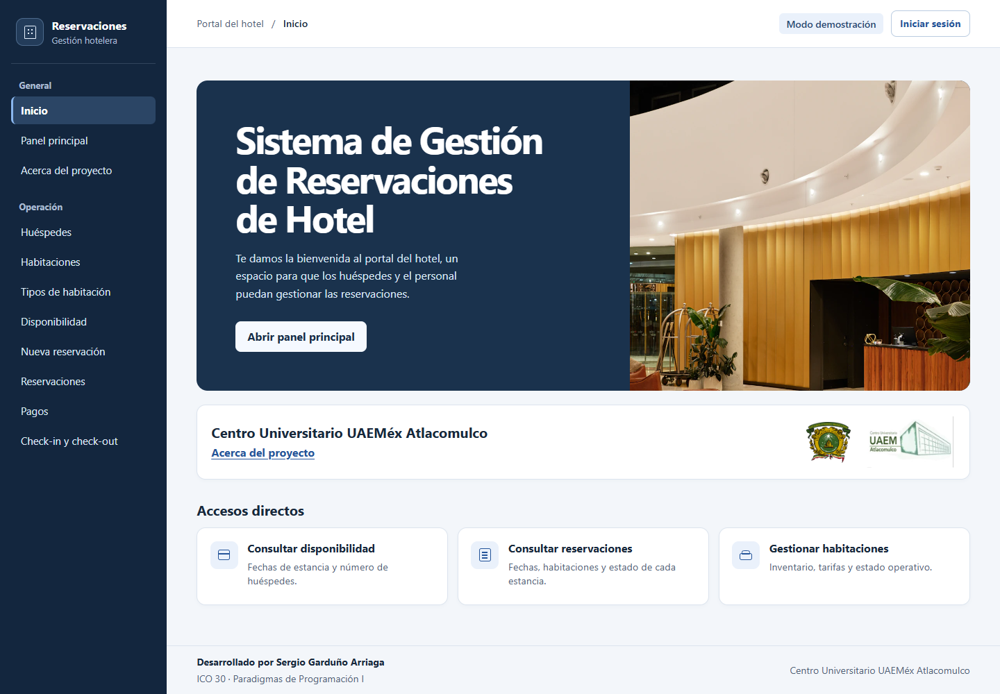

**Figure 1. Application home page.** The landing page shows the main entry points and institutional branding.

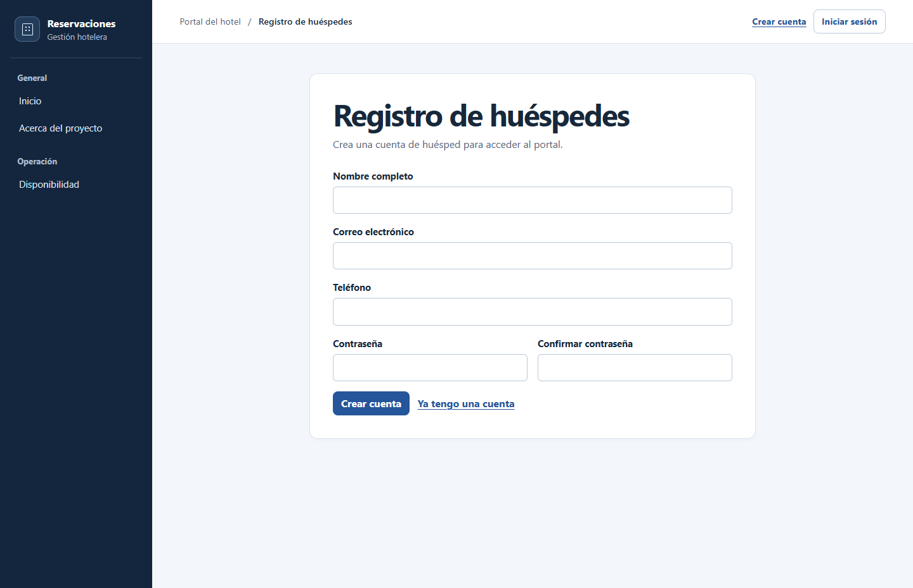

**Figure 2. Public guest registration.** The form collects guest profile and credential fields. Password values are absent from the capture.

<!-- page -->

### Sign-in and reception dashboard

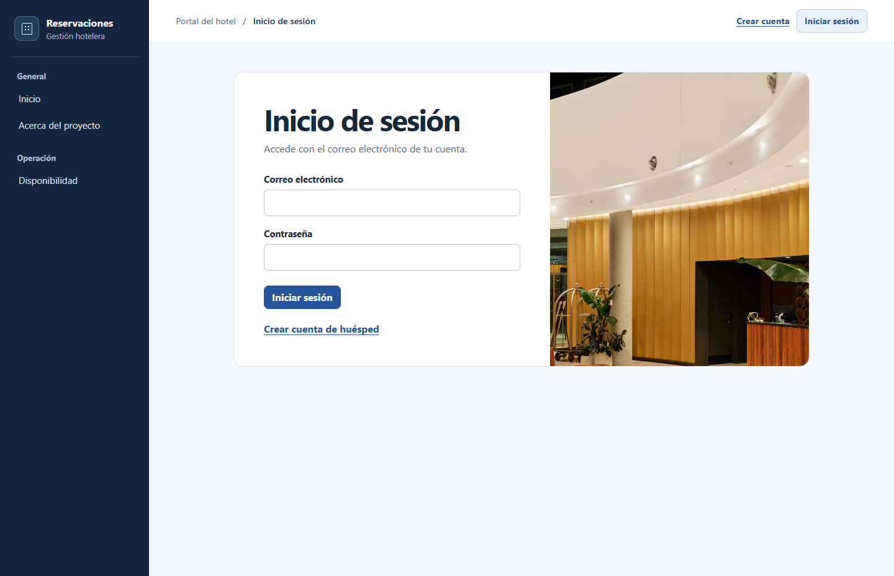

**Figure 3. Sign-in form.** All roles authenticate by email through the same form.

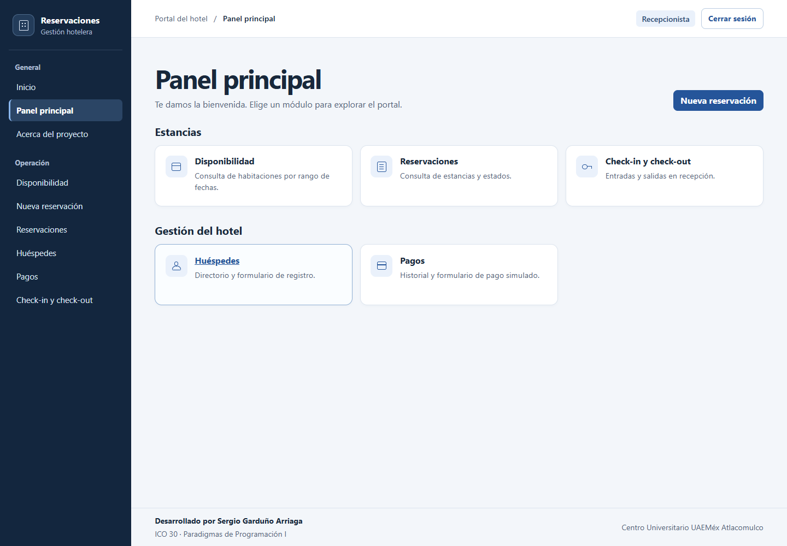

**Figure 4. Reception dashboard.** This earlier-stage capture shows the role-specific navigation and access to operations.

<!-- page -->

### Guest records and room inventory

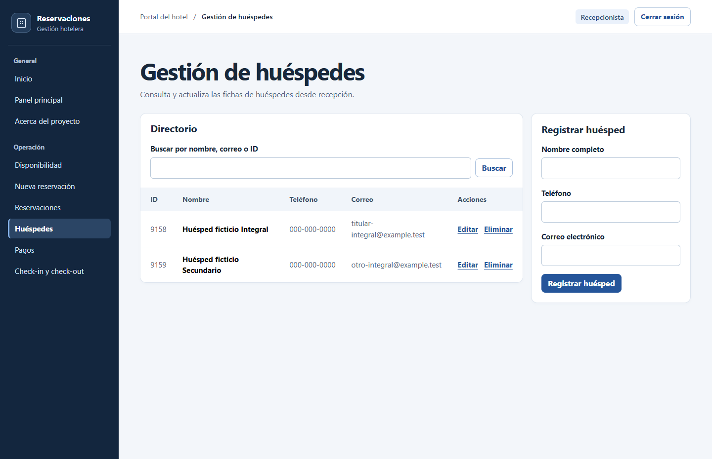

**Figure 5. Guest management.** Reception can consult the directory and create or manage a guest profile.

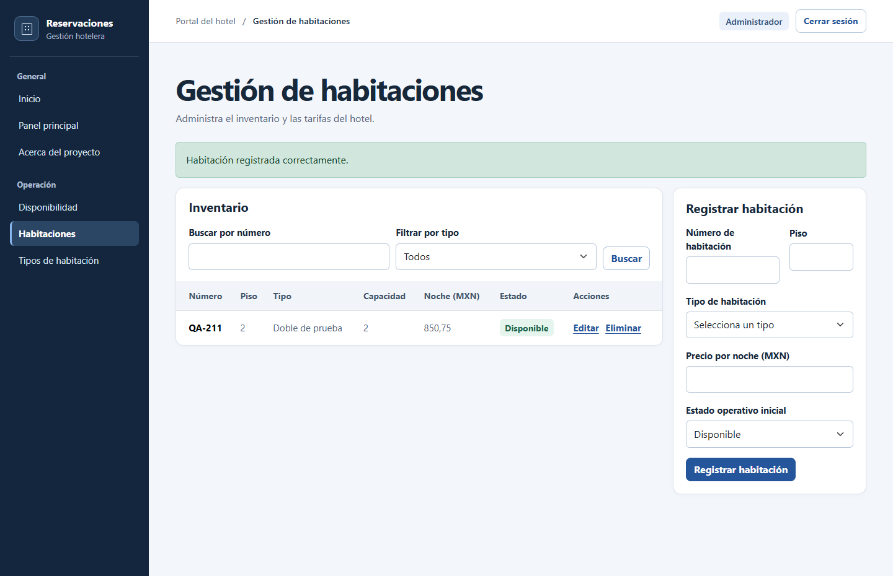

**Figure 6. Room inventory.** Administration adds a fictional room with a floor, type, price, and initial status.

<!-- page -->

### Room types and room availability

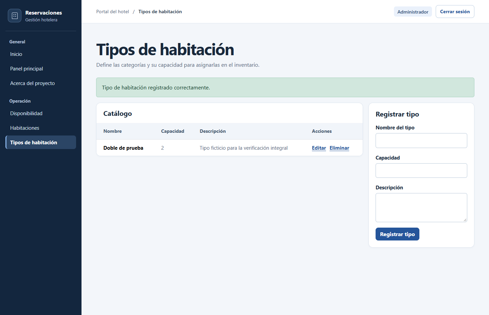

**Figure 7. Room type management.** The catalog contains the capacity and description used to classify rooms.

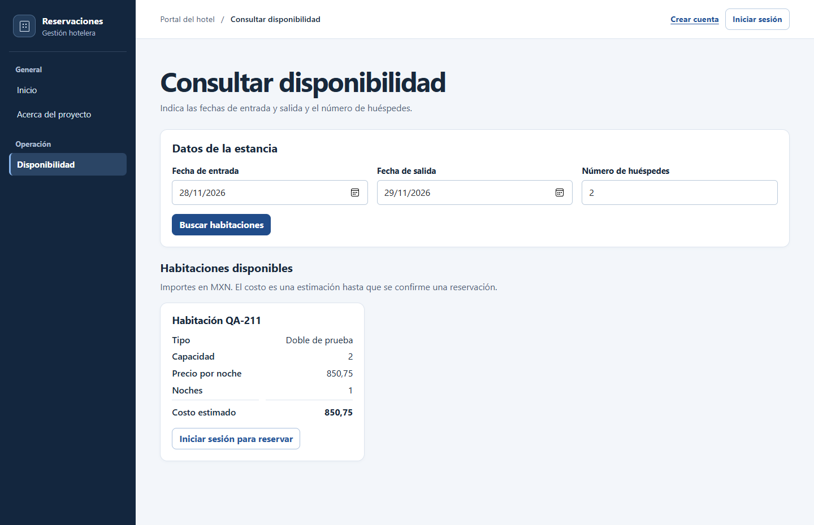

**Figure 8. Availability search results.** A public search shows available rooms and an estimated cost for future dates.

<!-- page -->

### Reservation and payment attempt

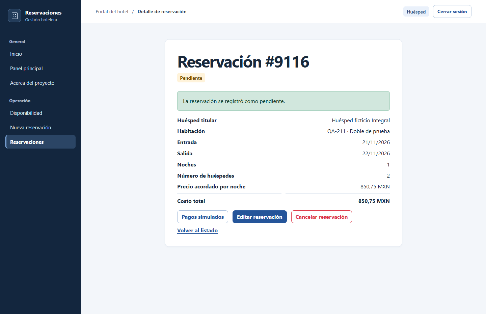

**Figure 9. Newly created reservation.** The saved booking is pending and displays its dates and agreed price.

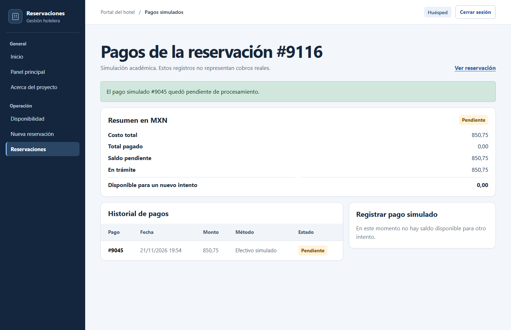

**Figure 10. Simulated payment attempt.** The submitted amount appears in the history, with approval still pending.

<!-- page -->

### Arrival and departure

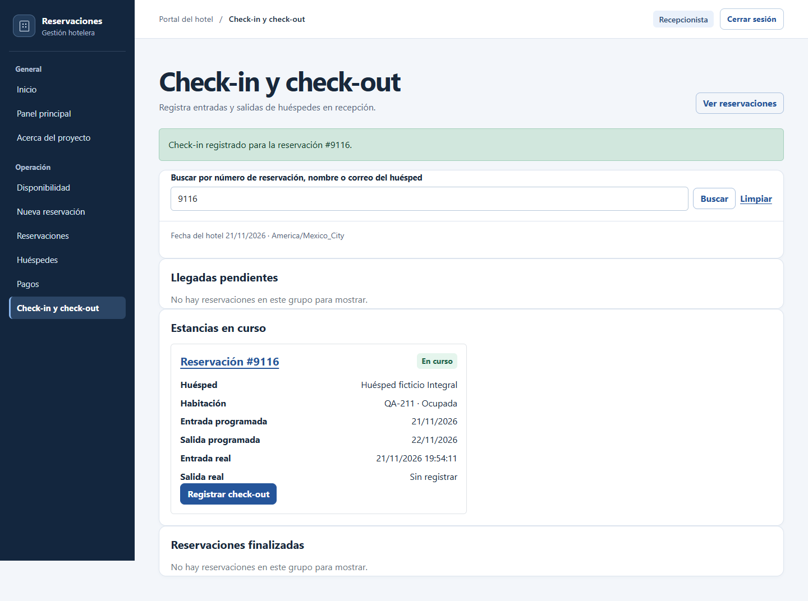

**Figure 11. Completed check-in.** The reception view shows an active stay and the room as occupied.

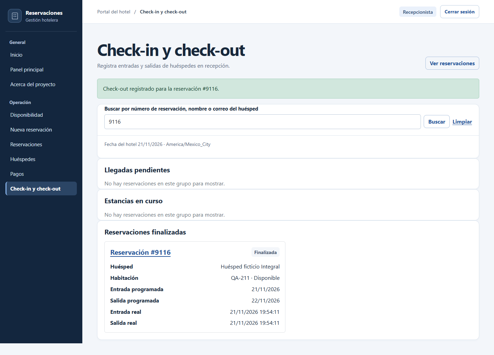

**Figure 12. Completed check-out.** The reservation is finalized. The actual departure is visible and the room is released.

<!-- page -->

### Validation and protected access

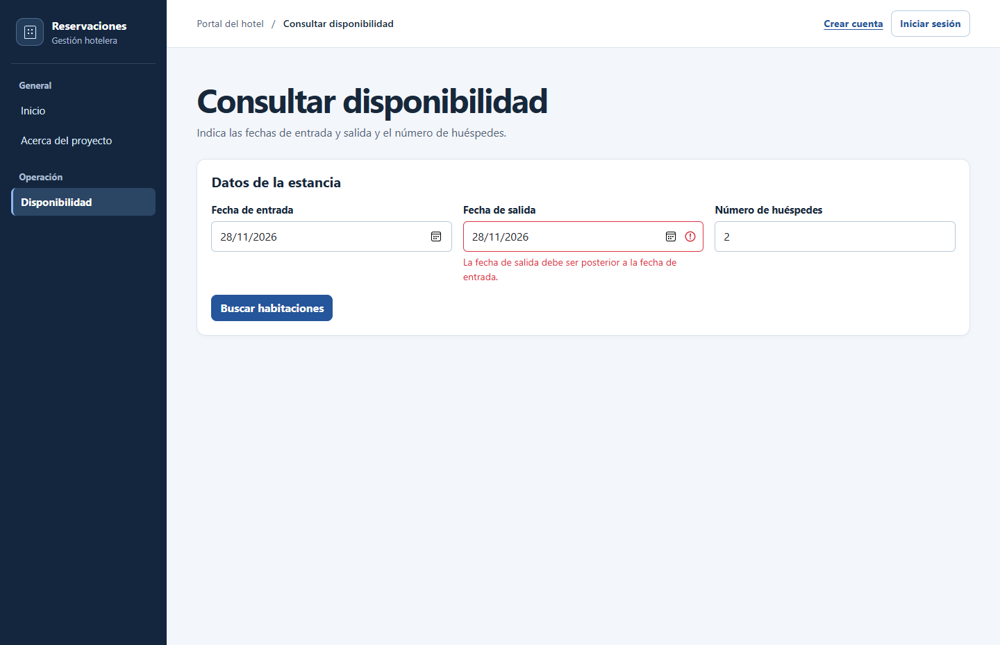

**Figure 13. Date validation.** Equal arrival and departure dates produce a message beside the departure field.

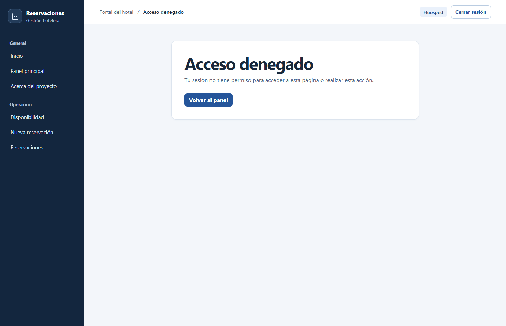

**Figure 14. Forbidden access.** The server rejects the authenticated guest's attempt to open another guest's payment history.

<!-- page -->

## 12. Conclusions

The project completed a controlled academic workflow from room setup and public availability to reservation, simulated payment, check-in, and check-out. The application can distinguish planned reservations from current occupancy and can preserve the agreed price after an inventory change. This addresses the original problem of checking availability and recording stays manually.

The most important distinction in the implementation is between operational room state and availability for a date range. A confirmed future booking can block another booking for the same interval even while the room is currently available. A cancellation releases the interval while preserving the audit trail. A stay records actual entry and exit times separately from its booked dates.

The implementation also demonstrates how security and transactions work together. Role and ownership checks protect guest data. Row locks protect reservation and payment decisions when requests arrive at the same time. The tests verify that conflicting operations fail with understandable feedback and leave consistent database records.

The results apply to a local academic system with fictional test data. Future work could establish a measurable throughput target, test realistic concurrent load, and review legacy rows with missing timestamps or inconsistent balances. Any connection to real payments would require a separately designed and evaluated workflow.

<!-- page -->

## References

### Academic and project sources

1. Sergio Garduño Arriaga. `Documento de Requerimientos.docx`. Original problem statement, objective, and actor descriptions.
2. Sergio Garduño Arriaga. `A6 Exposición Proyecto (equipos) (Primeros diagramas UML).pptx`. Slides 3-6 for RF01-RF14 and RNF01-RNF06. Slides 19-21 and 30-32 for the original model and state diagrams.
3. `Diagramas_Hotel_PlantUML_Corregidos.zip` and the original editable PlantUML sets in `Proyecto diagramas` and `Diagramas Proyecto`. Conceptual designs preserved separately from the delivery UML.
4. ReservacionesHotel source code, tests, migrations, and incremental implementation history. [GitHub repository](https://github.com/Sergio1200/SistemaReservacionesHotel)
5. Stage 11 integration evidence and requirement mapping. [Test matrix](../pruebas/matriz_pruebas.md) and [requirements assessment](../pruebas/cumplimiento_requerimientos.md).

### Technical sources

6. Spring. [Spring Web MVC reference](https://docs.spring.io/spring-framework/reference/web/webmvc.html).
7. Spring. [Spring Security for servlet applications](https://docs.spring.io/spring-security/reference/servlet/index.html).
8. Oracle. [MySQL 8.0 Reference Manual on InnoDB locking](https://dev.mysql.com/doc/refman/8.0/en/innodb-locking.html).
9. Redgate. [Flyway documentation](https://documentation.red-gate.com/flyway).
10. Apache Software Foundation. [Apache Maven Wrapper](https://maven.apache.org/tools/wrapper/).
11. PlantUML. [UML diagram reference](https://plantuml.com/).

<!-- page -->

## Appendix A UML diagrams

The new diagrams describe the current implementation. The English labels explain behavior. Java and SQL identifiers stay as they appear in the source. The original diagrams remain separate.

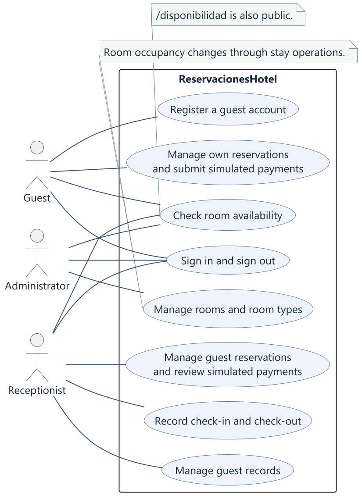

**Figure A1. Implemented use cases.** The public availability search is shared. Reservation ownership, guest management, stay operations, and inventory have separate role boundaries.

<!-- page -->

### Domain classes

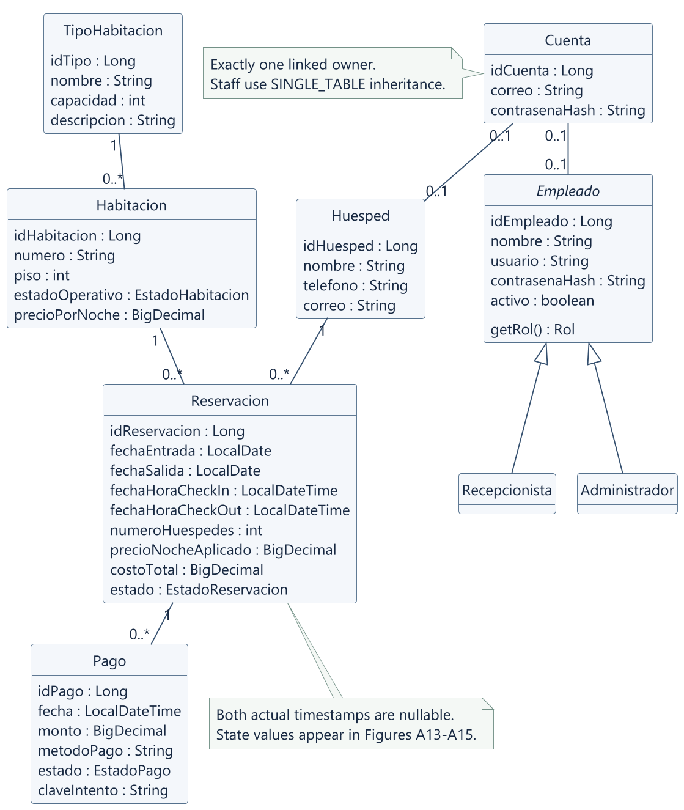

**Figure A2. Domain classes.** `Recepcionista` and `Administrador` really inherit from `Empleado`. `Cuenta` links to one owner. The diagram separates optional actual timestamps from planned dates.

<!-- page -->

### Authentication and registration sequences

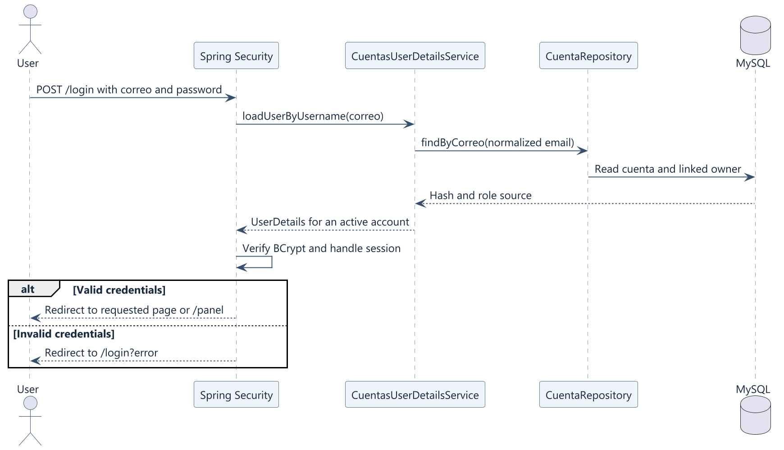

**Figure A3. Sign-in.** Spring Security handles the credential submission, checks BCrypt, and establishes the session.

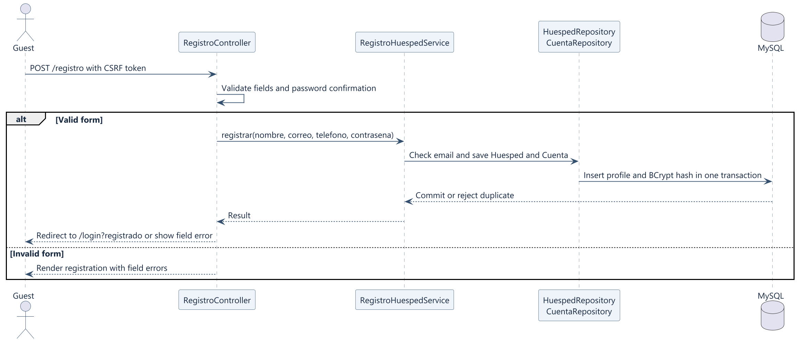

**Figure A4. Guest registration.** The controller checks the submitted form and the service creates the profile and account together.

<!-- page -->

### Availability and reservation sequences

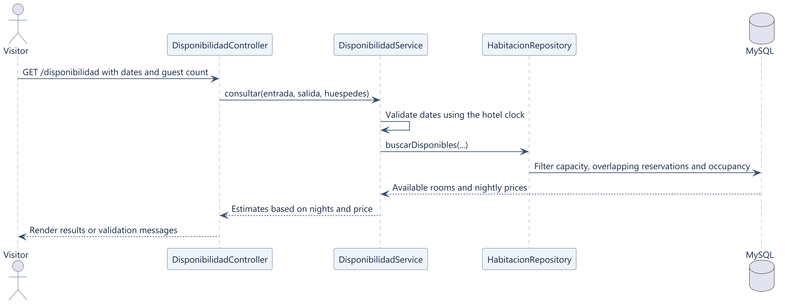

**Figure A5. Availability.** The service checks the hotel date and the repository selects rooms using the interval and guest count.

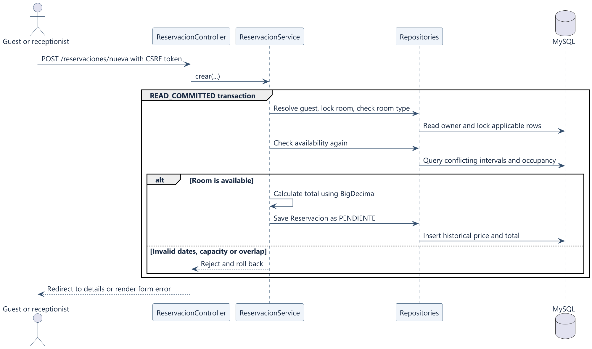

**Figure A6. Booking creation.** The application locks the room and confirms availability before inserting the booking with a historical price.

<!-- page -->

### Editing and cancellation sequences

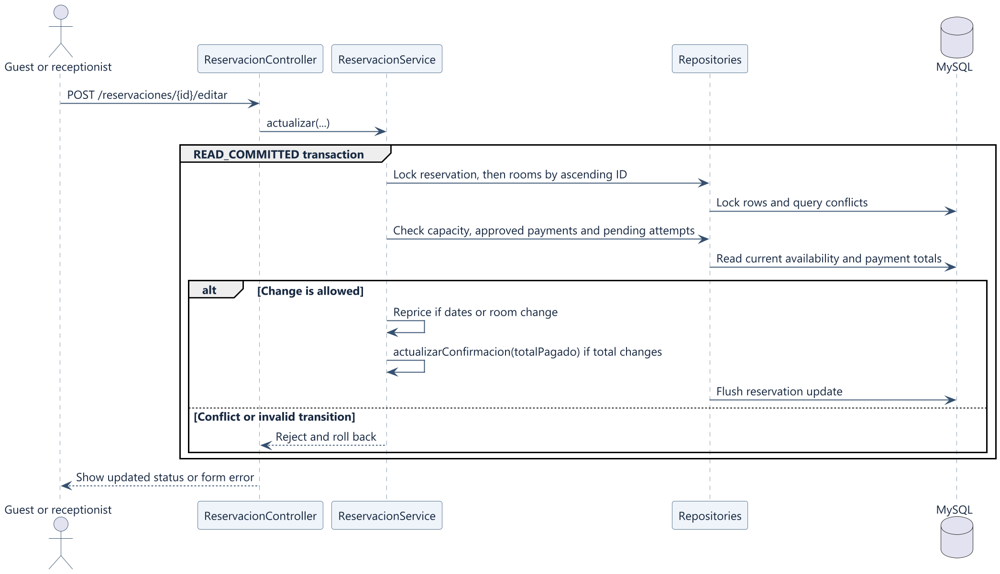

**Figure A7. Reservation change.** Repricing and reconciliation occur after the application acquires the reservation and room locks.

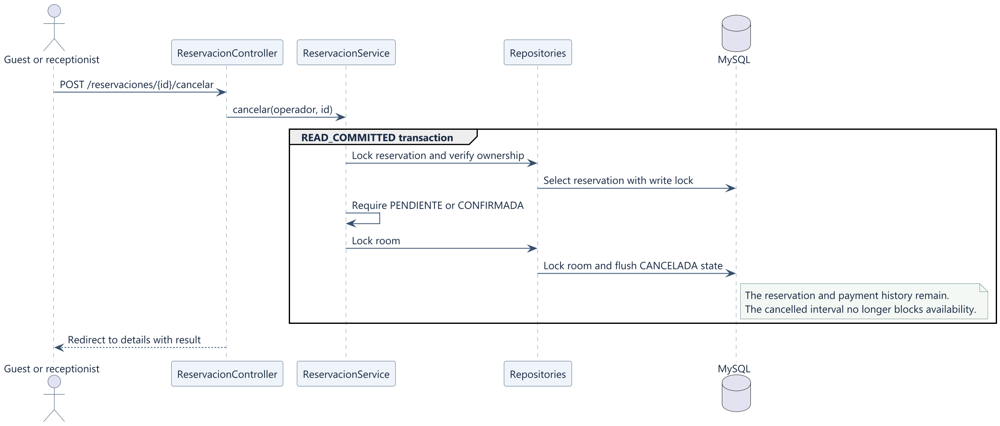

**Figure A8. Cancellation.** The transaction preserves the booking and payment history while releasing the cancelled interval.

<!-- page -->

### Payment sequences

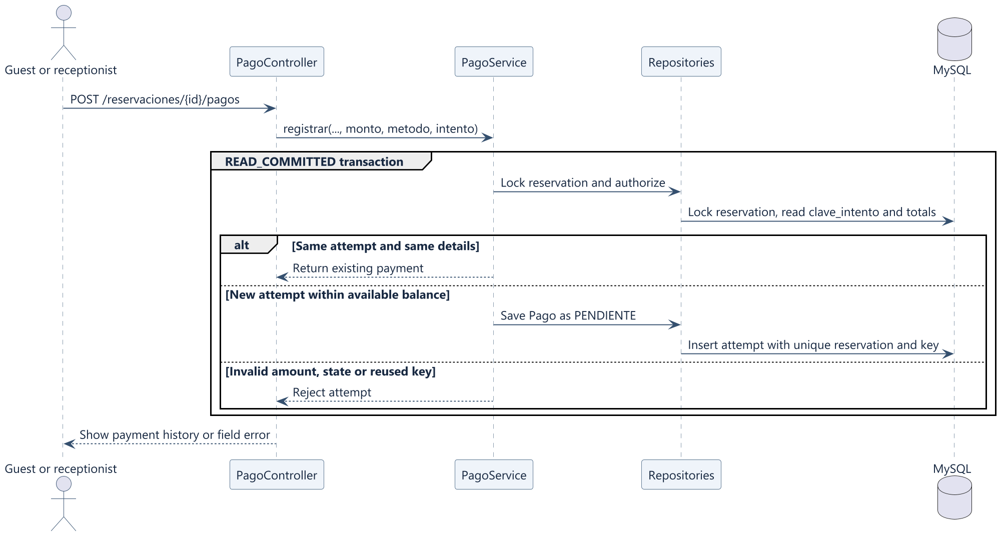

**Figure A9. Payment attempt.** The attempt key and available balance are checked before the application inserts a simulated payment.

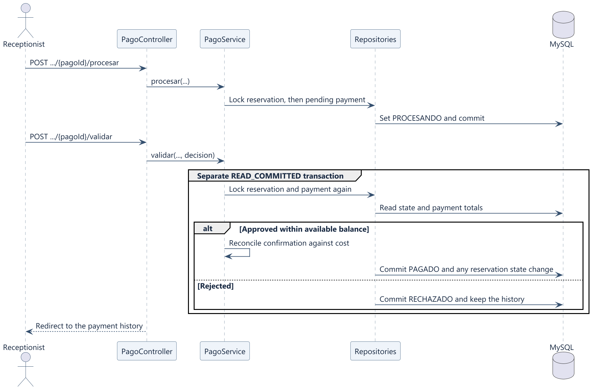

**Figure A10. Payment review.** Starting review and deciding the result are separate transactions. Approval may confirm the reservation.

<!-- page -->

### Stay sequences

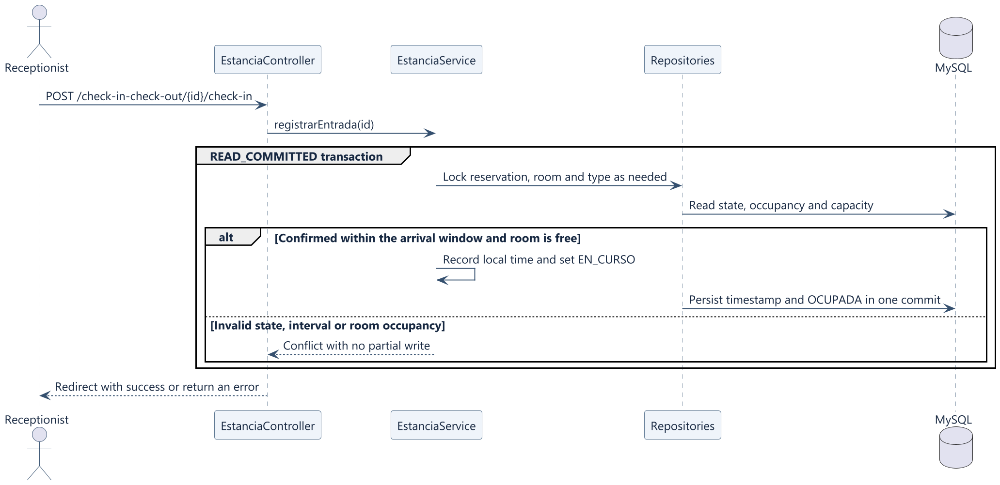

**Figure A11. Check-in.** A single transaction records the arrival and changes the room to occupied.

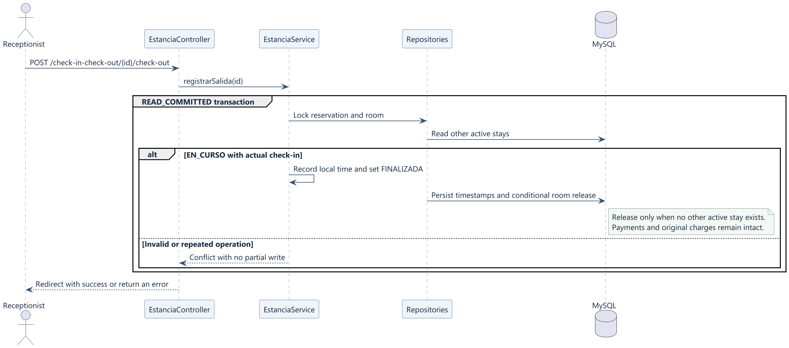

**Figure A12. Check-out.** A single transaction records departure and releases the room only when no other active stay prevents it.

<!-- page -->

### Reservation and payment states

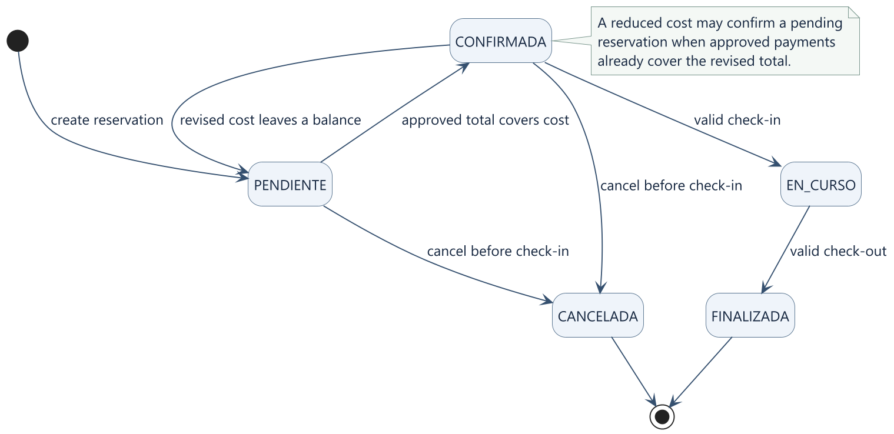

**Figure A13. Reservation states.** Repricing may return a confirmed reservation to pending if a balance remains. Check-in and check-out still require their authorized starting states.

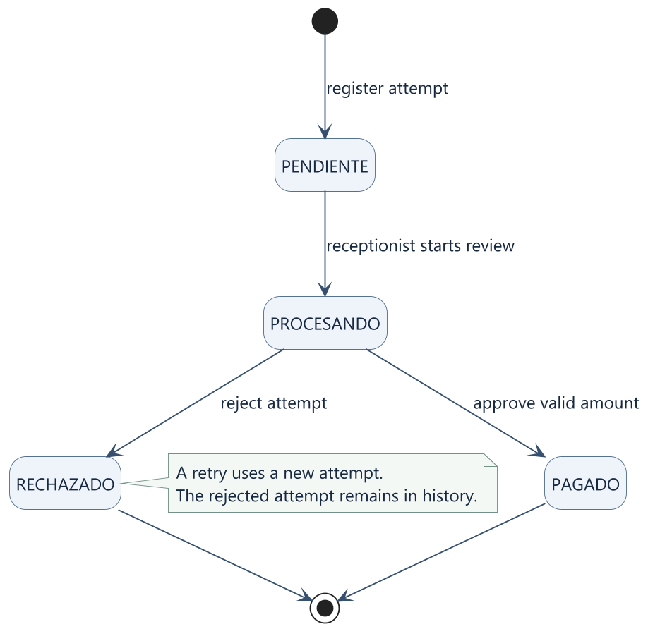

**Figure A14. Simulated payment states.** The rejected attempt remains in the history. A new attempt starts in `PENDIENTE`.

<!-- page -->

### Room operational states

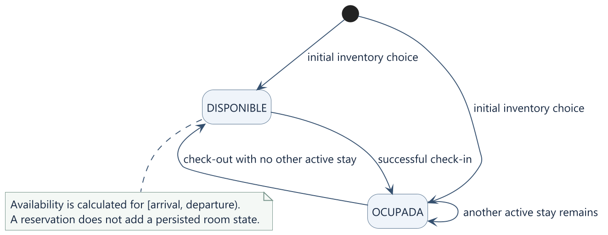

**Figure A15. Room operational states.** The application stores `DISPONIBLE` and `OCUPADA`. Whether the room can be booked for a particular interval is calculated from reservations. The original conceptual UML included a reserved room state. The corrected and implemented designs handle that condition through the date-based search.

The original requirements brief allows the administrator to change room status directly. In the application, administration sets the initial state in inventory. Later state changes follow verified check-in and check-out actions. This difference keeps room occupancy aligned with the state of a real stay.

<!-- page -->

### Relational model

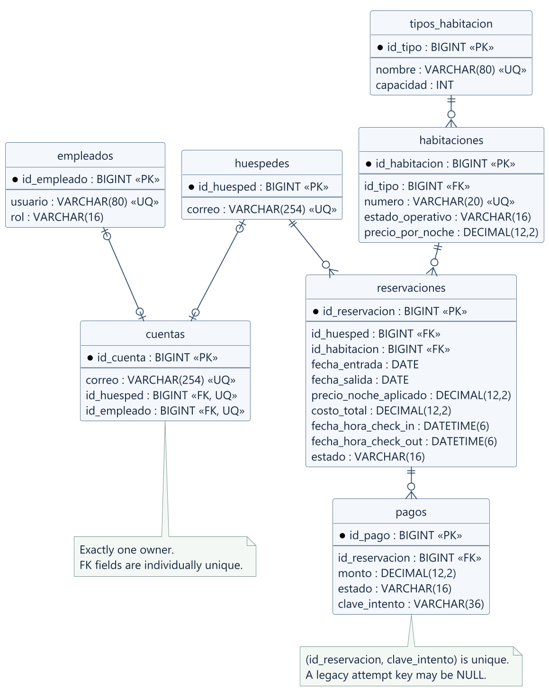

**Figure A16. MySQL entity relationships.** V1-V4 define the seven business tables and their primary, foreign and unique keys. The diagram omits Flyway's internal history table from the business model. Its six foreign keys were verified in the isolated MySQL instance.

<!-- page -->

## Appendix B Supporting materials

Full evidence and reproducible setup are available in the repository. The links below point to the corresponding sources and delivery files.

| Material | Purpose |
| --- | --- |
| [Full test matrix](../pruebas/matriz_pruebas.md) | All 39 executed scenarios with inputs, observations, and evidence. |
| [RF01-RF14 assessment](../pruebas/cumplimiento_requerimientos.md) | Functional traceability, design differences, and nonfunctional coverage. |
| [Installation manual](manual_instalacion.md) | Setup and verification with Java 21, Maven, NetBeans, and MySQL. |
| [SQL instructions and resources](sql/README.md) | Schema creation, migration references, optional synthetic inventory, and SELECT checks. |
| [Editable and rendered UML](uml/README.md) | Source and image index for all 16 diagrams. |
| [Live presentation script](guion_demostracion.md) | Fifteen-minute English presentation with a timed local application workflow. |
| [Video script](guion_video.md) | Recording order and English narration with preparation and privacy checks. |

### Source and evidence boundaries

The run counts come from Maven's test summaries. Stage 11 also recorded the application flow on an isolated database and verified the relevant tables directly. The historical data shown in the figures are fictional. The package keeps previously published test notes in their original language while presenting the report, figures, captions, and delivery explanation in English.
